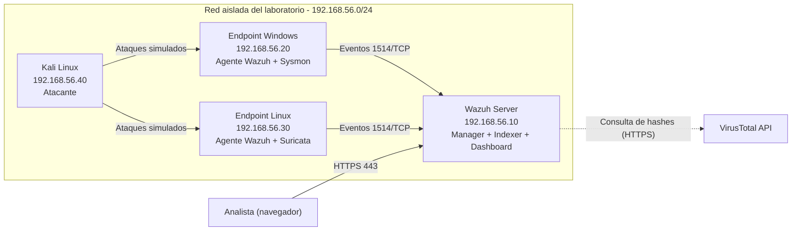

# 01 - Arquitectura del laboratorio

Este documento describe la arquitectura del home lab: los componentes, la topología de red, el flujo de datos y las integraciones adicionales (Sysmon, VirusTotal y Suricata).

## 1. Objetivo

Contar con un entorno aislado y controlado donde simular ataques reales, detectarlos con **Wazuh** (SIEM/XDR open source), analizar las alertas y documentar la respuesta, siguiendo el flujo de trabajo de un analista SOC.

## 2. Diagrama de arquitectura

## 3. Componentes

| Máquina | Hostname | IP (host-only) | Rol | SO | Recursos sugeridos |
|---|---|---|---|---|---|
| Wazuh Server | `wazuh-server` | 192.168.56.10 | Manager + Indexer + Dashboard (all-in-one) | Ubuntu Server 22.04 LTS | 4 vCPU, 8 GB RAM, 50 GB |
| Endpoint Windows | `win-endpoint` | 192.168.56.20 | Víctima monitoreada (agente Wazuh + Sysmon) | Windows 10/11 | 2 vCPU, 4 GB RAM, 40 GB |
| Endpoint Linux | `linux-endpoint` | 192.168.56.30 | Víctima monitoreada (agente Wazuh + Suricata, servicios SSH y web) | Ubuntu/Debian | 1-2 vCPU, 2 GB RAM, 20 GB |
| Atacante | `kali-attacker` | 192.168.56.40 | Generación de ataques simulados | Kali Linux | 2 vCPU, 4 GB RAM, 30 GB |

> Las direcciones IP son una propuesta. Ajústalas según el rango que asigne tu hipervisor y actualiza esta tabla.

## 4. Topología de red

- **Hipervisor:** VirtualBox o VMware (indicar versión utilizada).
- **Adaptador 1 (host-only / red interna):** red `192.168.56.0/24`, donde se comunican todas las VMs. Aquí ocurren los ataques y el envío de eventos.
- **Adaptador 2 (NAT):** solo para instalaciones y actualizaciones. Se recomienda **desactivarlo en las VMs víctima** una vez terminada la configuración, para mantener el laboratorio aislado.
- El anfitrión accede al dashboard de Wazuh desde el navegador: `https://192.168.56.10`.

### Puertos relevantes

| Puerto | Protocolo | Origen → Destino | Uso |
|---|---|---|---|
| 1514 | TCP | Agentes → Wazuh Manager | Envío de eventos |
| 1515 | TCP | Agentes → Wazuh Manager | Registro (enrollment) de agentes |
| 55000 | TCP | Dashboard/Analista → Wazuh API | API REST del manager |
| 9200 | TCP | Manager/Dashboard → Indexer | Indexación y consulta de alertas |
| 443 | TCP | Analista → Dashboard | Interfaz web |
| 22 | TCP | Kali → Endpoint Linux | Objetivo de casos SSH |
| 3389 / 445 | TCP | Kali → Endpoint Windows | Objetivo de casos RDP/SMB |

## 5. Flujo de datos

1. Los **agentes de Wazuh** recolectan logs del sistema, eventos de seguridad, cambios en archivos (FIM) y eventos de Sysmon o Suricata.
2. Los eventos se envían cifrados al **Wazuh Manager** (puerto 1514).
3. El Manager los **decodifica y evalúa contra las reglas** (incluidas las personalizadas del repositorio) y genera alertas.
4. Las alertas se **indexan en el Wazuh Indexer**.
5. El analista las **visualiza y analiza en el Dashboard**.
6. Opcionalmente, el Manager **consulta VirusTotal** para enriquecer alertas con reputación de archivos, y puede ejecutar **Active Response** (por ejemplo, bloquear una IP).

## 6. Integraciones adicionales

### 6.1 Sysmon (endpoint Windows)

- **Función:** telemetría detallada del sistema (creación de procesos, conexiones de red, modificación de registro, carga de librerías).
- **Configuración base:** SwiftOnSecurity `sysmon-config` o `sysmon-modular` (indicar cuál se usó y la versión).
- **Integración:** el agente de Wazuh lee el canal `Microsoft-Windows-Sysmon/Operational`.
- **Valor para el laboratorio:** permite detectar PowerShell sospechoso, persistencia y ejecución de procesos anómalos.
- **Ubicación en el repositorio:** `configs/sysmon/`.

### 6.2 VirusTotal (Wazuh Manager)

- **Función:** enriquecer las alertas del módulo FIM con la reputación de los archivos (hash) detectados.
- **Integración:** módulo `integration` de Wazuh configurado en `ossec.conf`.
- **Consideraciones:**
  - La API gratuita tiene límites de uso (pocas consultas por minuto y por día).
  - **La clave de API nunca debe subirse al repositorio.** En `configs/ossec.conf` deja un marcador como `<api_key>TU_API_KEY_AQUI</api_key>`.

### 6.3 Suricata (endpoint Linux)

- **Función:** IDS de red que detecta escaneos, tráfico sospechoso y firmas de ataques conocidos.
- **Integración:** el agente de Wazuh lee el archivo `/var/log/suricata/eve.json`.
- **Reglas:** Emerging Threats Open (actualizadas con `suricata-update`).
- **Limitación a tener en cuenta:** Suricata solo ve el tráfico que llega a la interfaz donde está instalado. Si quieres que inspeccione tráfico entre otras VMs, habilita el modo promiscuo en el adaptador host-only del hipervisor y documéntalo.

## 7. Requisitos del anfitrión

| Recurso | Mínimo recomendado |
|---|---|
| RAM | 16 GB (si no alcanza, levantar solo Wazuh, Windows y Kali al inicio) |
| CPU | 4 núcleos con virtualización habilitada (VT-x/AMD-V) |
| Disco | 150 GB libres (preferible SSD) |

## 8. Consideraciones de seguridad del laboratorio

- Todos los ataques se ejecutan **únicamente dentro de la red aislada** y contra máquinas propias.
- Tomar **snapshots** de cada VM antes de cada simulación para poder restaurar el estado limpio.
- Cambiar las credenciales por defecto de Wazuh tras la instalación.
- No exponer el dashboard de Wazuh a internet.
- No subir al repositorio contraseñas, claves de agentes, tokens ni certificados (revisar el `.gitignore`).

*Siguiente documento: [02 - Instalación](02-instalacion.md)*